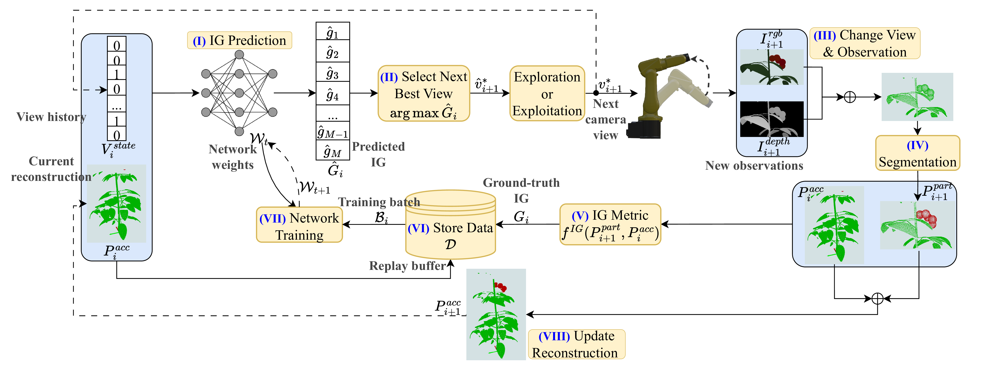

# SSL-Semantic-NBV

<p align="center">
  <a href="https://wur-abe.github.io/SSL-Semantic-NBV/"> <strong>Project</strong></a> ·
  <a href="https://rasevents.org/uploads/documents/pdfviewer/06/9c/232604-0784.pdf"> <strong>Paper</strong></a>
</p>

<p align="center">
  
</p>

## Requirements

- Ubuntu 20.04, ROS Noetic (with Gazebo 11)
- Python 3.8 (the system Python of Ubuntu 20.04) and [uv](https://docs.astral.sh/uv/)
- An NVIDIA GPU with CUDA (tested on an RTX A5000 with PyTorch 1.11 + CUDA 11.3)

## Installation

All commands in this README are run from the workspace root (the cloned folder).

```bash
git clone https://github.com/WUR-ABE/SSL-Semantic-NBV.git
cd SSL-Semantic-NBV
```

### 1. ROS packages

```bash
sudo apt-get install ros-noetic-octomap-msgs ros-noetic-moveit-visual-tools ros-noetic-moveit \
    ros-noetic-ros-controllers ros-noetic-trac-ik ros-noetic-ddynamic-reconfigure \
    ros-noetic-realsense2-camera ros-noetic-rgbd-launch
rosdep install --from-paths src --ignore-src -r -y
```

### 2. Python environment

The Python packages are installed with [uv](https://docs.astral.sh/uv/) into a virtual environment
`.venv` in the workspace root. It uses the system Python 3.8 of Ubuntu 20.04, the same one ROS Noetic is
built for, and it does not touch any other Python installation.

```bash
curl -LsSf https://astral.sh/uv/install.sh | sh     # install uv, if you do not have it yet

uv venv --python 3.8 .venv
source .venv/bin/activate

uv pip install torch==1.11.0+cu113 torchvision==0.12.0+cu113 torchaudio==0.11.0 \
    --extra-index-url https://download.pytorch.org/whl/cu113 --index-strategy unsafe-best-match
uv pip install fvcore iopath
uv pip install pytorch3d --no-index \
    --find-links https://dl.fbaipublicfiles.com/pytorch3d/packaging/wheels/py38_cu113_pyt1110/download.html
uv pip install torch-scatter==2.0.9 --find-links https://data.pyg.org/whl/torch-1.11.0+cu113.html
uv pip install -r requirements.txt
# Optional: only to run SAM3 on new images (src/sam3_detector)
uv pip install ultralytics
```

This takes about one minute.

### 3. Build

```bash
source /opt/ros/noetic/setup.bash
catkin_make -DCMAKE_BUILD_TYPE=Release -DPYTHON_EXECUTABLE=/usr/bin/python3
source devel/setup.bash
```

Check the installation (should print `ok`):

```bash
source .venv/bin/activate
python3 -c "import torch, pytorch3d, torch_scatter, open3d, pfrl, rospy; assert torch.cuda.is_available(); print('ok')"
```

### 4. Download the data

Large files are not stored in git. Download `simulation.zip`, `real_world.zip` and `checkpoints.zip`
(about 8 GB) from 4TU.ResearchData: https://doi.org/10.4121/a4ad11c3-ef7f-4ff3-b841-df478109fc04

Unzip them into `~/nbv_data/`:

```bash
mkdir -p ~/nbv_data
unzip simulation.zip -d ~/nbv_data
unzip real_world.zip -d ~/nbv_data
unzip checkpoints.zip -d ~/nbv_data
```

All scripts read from there by default, so nothing has to be configured. Steps 1-3 write their output
into the same folder.

```
~/nbv_data/
├── simulation/                     # simulated plants 1-20
│   ├── meshes/plant<i>.ply         #   mesh exported from GroIMP (download)
│   ├── meshes/plant<i>.dae         #   same mesh converted for Gazebo (download)
│   ├── gt_nodes/                   #   fruit/node annotations (download)
│   ├── gt_pcd/                     #   ground-truth point clouds (created by step 1)
│   └── views/                      #   camera views rendered in Gazebo (created by step 2)
├── real_world/                     # real plants 31-40 (download), one folder per plant:
│   └── plant<i>/
│       ├── viewpoints.npy          #   camera poses
│       ├── pcd/                    #   recorded point cloud per view
│       ├── pcd_sam3/               #   same, with SAM3 fruit labels
│       ├── gt_pcd.pcd              #   ground truth
│       └── gt_fruit.csv, gt_internode.csv   # fruit/node annotations
└── checkpoints/                    # trained models (download, or created by step 3)
```

The `.ply` and `.dae` files are the same plant mesh in two formats: step 1 samples the ground truth from
the `.ply`, and Gazebo renders the views from the `.dae` (converted with MeshLab and Blender to make the
leaves double-sided and keep the colours). Evaluation results go to `src/drl_nbv_plan/materials/results/`.

If you keep the dataset somewhere else, set `export NBV_DATA_ROOT=/path/to/nbv_data`
(other overrides: `NBV_MODELS` for the checkpoints, `NBV_MATERIALS` for the results, `SAM3_CHECKPOINT`, see
[paths.py](src/common/utils/src/utils/paths.py)).

## Reproducing the paper

Each step writes to the folders above, and the next step reads from there.

| Step | Writes to | Time |
|---|---|---|
| 1. Ground-truth point clouds | `~/nbv_data/simulation/gt_pcd/` | < 1 min |
| 2. Render views in Gazebo | `~/nbv_data/simulation/views/` | ~1 day per plant set |
| 3. Training | `~/nbv_data/checkpoints/` | ~1-1.5 h per model, 21 models |
| 4. Evaluation | `materials/results/` | a few hours |
| 5. Real-world experiments (optional) | `~/nbv_data/checkpoints/`, `materials/results/` | |

- **Only evaluate?** Download the data, run steps 1 and 2 to create the simulated data, then go to step 4.
- **Full reproduction?** Run steps 1 to 5 in order (about 3-4 days on an RTX A5000).

In every new terminal, first run:

```bash
source devel/setup.bash
source .venv/bin/activate
```

Run the steps one after another, not in parallel.

**Names used below:** `experiment` = `0` normal plants (1-10), `1` heavily occluded plants (11-20),
`2` real plants (31-40); test plants are 3, 6, 9 / 13, 16, 19 / 33, 36, 39. `recon_target` = `PLANT`,
`FRUIT` or `NODE`. `ssl_semantic_nbv_NOCOLOR` is the model of the paper; `ssl_nbv` is the baseline.
`voxel_global_nbv` is a voxel-based semantic NBV planner adapted from
[gradientnbv](https://github.com/akshaykburusa/gradientnbv).

### Step 1: ground-truth point clouds

```bash
python3 src/offline_experiments/src/offline_experiments/get_gt_pcd_from_mesh.py
```

Reads `~/nbv_data/simulation/meshes/*.ply`, writes `~/nbv_data/simulation/gt_pcd/`.

### Step 2: render the views in Gazebo

Normal plants 1-10 (~1 day):

```bash
roslaunch offline_experiments collect_view_data.launch experiment:=0
```

When it has finished (or stopped), press Ctrl+C to close it, then run the heavily occluded plants
11-20 (~1 day):

```bash
roslaunch offline_experiments collect_view_data.launch experiment:=1
```

Writes `~/nbv_data/simulation/views/plant<i>/` (about 32 GB). Gazebo and RViz open by themselves.

- If it stops, run the same command again; finished views are skipped.
- For faster rendering, add `gui:=false rviz:=false` to run without the Gazebo and RViz windows.
- The red message `l515_spawn ... Spawn service failed` at start-up can be ignored.
- Quick test (1 min): add `plants:=1 x_range:=0 y_range:=0 z_range:=0 rotations:=0`.

### Step 3: training

```bash
# SSL-Semantic-NBV and the SSL-NBV baseline (12 models)
for experiment in 0 1; do
  for target in PLANT FRUIT NODE; do
    roslaunch drl_nbv_plan ssl_nbv_train.launch experiment:=$experiment recon_target:=$target \
        planners:=ssl_semantic_nbv_NOCOLOR,ssl_nbv
  done
done

# Ablations (9 models)
for target in PLANT FRUIT NODE; do
  roslaunch drl_nbv_plan ssl_nbv_train.launch experiment:=0 recon_target:=$target \
      planners:=ssl_semantic_nbv_NOPE_NOCOLOR,ssl_semantic_nbv_NOPE_NOLF_NOCOLOR,ssl_semantic_nbv_NOPE_NOLF_NOIG_NOCOLOR
done
```

Writes `~/nbv_data/checkpoints/<experiment>_<target>_<planner>/` (see [layout](src/drl_nbv_plan/materials/train/README.md)).

- Training does not overwrite existing checkpoints (e.g. downloaded ones); add `overwrite:=true` to replace them.
- Progress: `tensorboard --logdir ~/nbv_data/checkpoints`.

### Step 4: evaluation

```bash
# Compare planners (normal and heavy-occlusion plants)
for target in PLANT FRUIT NODE; do
  roslaunch drl_nbv_plan ssl_nbv_compare_diff_planners.launch recon_target:=$target
  roslaunch drl_nbv_plan ssl_nbv_compare_diff_planners_heavy_occlusion.launch recon_target:=$target
done

# Ablation study
roslaunch drl_nbv_plan ssl_nbv_ablation_test.launch targets:=PLANT,FRUIT,NODE

# Semantic awareness (trained for one target, tested on another)
for train in PLANT FRUIT NODE; do
  for recon in PLANT FRUIT NODE; do
    roslaunch drl_nbv_plan ssl_nbv_test_semantic_awareness.launch train_target:=$train recon_target:=$recon
  done
done
```

Reads the checkpoints from `~/nbv_data/checkpoints/`, writes CSV files (coverage per view and AUC) to
`materials/results/<script>/<timestamp>/`. Add `max_test:=2` for a quick test.

The results of the paper are in `materials/NO_COLOR_RESULTS/` for comparison; the figures are made with
[anslysis_results.ipynb](src/drl_nbv_plan/src/drl_nbv_plan/anslysis_results.ipynb).

### Step 5: real-world experiments (optional)

```bash
# Fine-tune on the real plants (starts from the step 3 models)
for target in PLANT FRUIT NODE; do
  roslaunch drl_nbv_plan ssl_nbv_train_RW.launch recon_target:=$target
done

# Fine-tune with SAM3 fruit labels instead of annotations (labels are in real_world/plant<i>/pcd_sam3/)
roslaunch drl_nbv_plan ssl_nbv_train_RW_sam3_pipeline.launch recon_target:=FRUIT

# Compare planners on the real plants (SSL-Semantic-NBV, predefined and random views)
for target in PLANT FRUIT NODE; do
  roslaunch drl_nbv_plan ssl_nbv_compare_diff_planners_RW.launch recon_target:=$target
done
roslaunch drl_nbv_plan ssl_nbv_compare_diff_planners_RW.launch recon_target:=FRUIT sam3:=true \
    planners:=ssl_semantic_nbv_NOCOLOR
```

Writes models to `~/nbv_data/checkpoints/2_<target>_.../` and results to
`materials/results/compare_diff_planners_RW/<timestamp>/`.

## Acknowledgements

The voxel-based semantic NBV planner (`voxel_global_nbv`, in [src/active_vision/](src/active_vision/)) is adapted from
[gradientnbv](https://github.com/akshaykburusa/gradientnbv) by Akshay K. Burusa.

## Citation

If you use this project, please cite the IROS 2026 paper:

```bibtex
@inproceedings{ci2026,
  author = {Ci, Jianchao and Smolenova, Katarina and Wang, Xin and Streit, Axel and Van Henten, Eldert J. and Kootstra, Gert},
  title = {{SSL-Semantic-NBV: A Self-Supervised Learning-Based NBV for Target-Aware 3D Reconstruction in Agricultural Robotics}},
  booktitle = {2026 IEEE/RSJ International Conference on Intelligent Robots and Systems (IROS)},
  year = {2026},
}
```

## License

GPL-3.0, see [LICENSE](LICENSE). Third-party packages in `src/dependencies/` and `src/ros_numpy/` keep their own licenses; the code in
`src/active_vision/` is adapted from [gradientnbv](https://github.com/akshaykburusa/gradientnbv).
